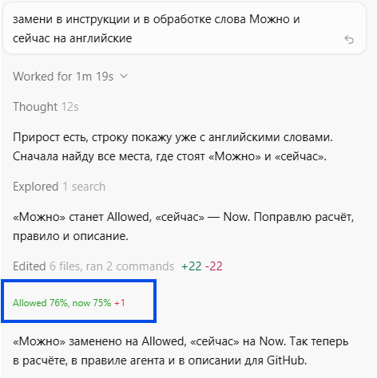

# Cursor plan usage line

Short text for the GitHub About field:

Shows a Cursor agent line like “Allowed 76%, now 74% +1” only when the plan usage percent goes up.



## What you see

The line appears once in the agent reply when the spent share of the plan increases. Example: it was 73% and became 74%. The reply shows “Allowed 76%, now 74%” with “+1” in red on the right.

If the percent did not go up, there is no line.

The line is small and not bold.

- Green when Now is below Allowed.
- Red when Now is equal to Allowed or higher.
- The difference on the right is always red and appears only in that one reply.

## How the numbers are calculated

Allowed is today’s day of the month divided by 30. On the 23rd that is 76%.

Now is the current Cursor plan usage percent, rounded to a whole number.

The increase is measured from the last saved Now value. A drop does not show the line.

## Files

- `.cursor/hooks.json` starts the check at session start and before each message.
- `.cursor/hooks/show-usage.py` reads plan usage and decides whether it increased.
- `.cursor/rules/show-date.mdc` tells the agent how to draw the line.

## Install in one project

You need Windows, Python on `PATH` as `python.exe`, and an active Cursor sign-in on this computer.

Copy the `.cursor` folder into the project root. Open a new agent chat. An existing chat does not pick up the rule.

## Install for every project

Copy `show-usage.py` to `%USERPROFILE%\.cursor\hooks\`.

Create `%USERPROFILE%\.cursor\hooks.json`:

```json
{
  "version": 1,
  "hooks": {
    "sessionStart": [
      {
        "command": "python.exe ./hooks/show-usage.py"
      }
    ],
    "beforeSubmitPrompt": [
      {
        "command": "python.exe ./hooks/show-usage.py"
      }
    ]
  }
}
```

The rule `.cursor/rules/show-date.mdc` still has to be placed in each project where the agent should draw the line.

## What stays out of the repository

On this computer the script reads the existing Cursor sign-in and requests plan usage. The token is not written into the repository files.

The last percent is stored locally in `%USERPROFILE%\.cursor\hooks\usage-last.json`. Do not upload that file to GitHub.

# Строка расхода тарифа Cursor

Короткое описание для поля About на GitHub:

Показывает в окне агента Cursor строку «Allowed 76%, now 74% +1» только в тот момент, когда процент расхода тарифа вырос.


## Что видит пользователь

Строка появляется в ответе агента один раз, когда доля потраченного тарифа увеличилась. Пример: было 73%, стало 74%. В ответе будет «Allowed 76%, now 74%» и справа красным «+1».

Если процент не вырос, строки нет.

Строка маленькая, без жирного шрифта.

- Зелёная, если Now меньше, чем Allowed.
- Красная, если Now равно Allowed или больше.
- Разница справа всегда красная и показывается только в этом одном ответе.

## Как считаются числа

Allowed — это сегодняшнее число месяца, делённое на 30. Для 23-го числа это 76%.

Now — общий процент расхода текущего тарифа Cursor, округлённый до целого.

Прирост считается от предыдущего сохранённого значения Now. Падение процента строку не показывает.

## Состав

- `.cursor/hooks.json` запускает расчёт в начале сессии и перед каждым сообщением.
- `.cursor/hooks/show-usage.py` читает расход тарифа и решает, был ли прирост.
- `.cursor/rules/show-date.mdc` говорит агенту, как нарисовать строку.

## Установка в один проект

Нужны Windows, Python в `PATH` под именем `python.exe` и вход в Cursor на этом компьютере.

Скопируйте папку `.cursor` в корень проекта. Откройте новый чат агента. Старый чат это правило не подхватит.

## Установка для всех проектов

Скопируйте `show-usage.py` в `%USERPROFILE%\.cursor\hooks\`.

Создайте `%USERPROFILE%\.cursor\hooks.json`:

```json
{
  "version": 1,
  "hooks": {
    "sessionStart": [
      {
        "command": "python.exe ./hooks/show-usage.py"
      }
    ],
    "beforeSubmitPrompt": [
      {
        "command": "python.exe ./hooks/show-usage.py"
      }
    ]
  }
}
```

Правило `.cursor/rules/show-date.mdc` всё равно нужно положить в каждый проект, где агент должен рисовать строку.

## Что не попадает в репозиторий

Скрипт на этом компьютере читает уже существующий вход Cursor и запрашивает расход тарифа. Токен в файлы репозитория не записывается.

Последний процент хранится локально в `%USERPROFILE%\.cursor\hooks\usage-last.json`. Этот файл не нужно загружать на GitHub.
